# AlertaEncosta · Painel da Defesa Civil (C# Windows Forms)

> FIAP · Global Solution 2026.2 · CitizenTech · Engenharia de Software, 3º ano
> Disciplina: **C# Software Development** · versão **1.0.0** ([CHANGELOG](CHANGELOG.md))

Este repositório contém a **parte de C#** do projeto **AlertaEncosta**: o painel desktop que o agente da Defesa Civil usa para acompanhar os sensores do bairro, decidir quando emitir alerta, mandar os moradores para o ponto de apoio certo, saber quem já está seguro e quem precisa ser buscado, e atender as ocorrências.

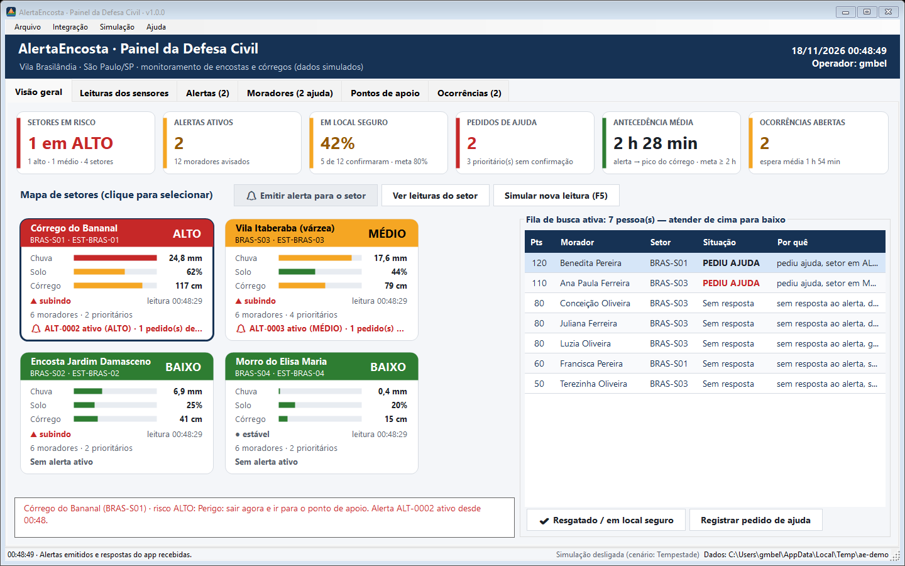

## Integrantes

| Integrante | RM |
|---|---|
| Gustavo Neri Santos | RM560239 |
| Matheus Aparecido Rocha Plati | RM559813 |
| Gustavo Pandolfo Meroni | RM560271 |
| Gabriel Machado Belardino | RM550121 |
| Gustavo Franco Tárano | RM559616 |

## Ficha da CitizenTech

| Item | Descrição |
|---|---|
| **Nome** | AlertaEncosta |
| **Cidade e bairro** | São Paulo (SP) · Vila Brasilândia, zona norte |
| **Cidadão beneficiado** | Moradores de encostas e áreas alagáveis (prioridade: idosos e pessoas com deficiência). **Usuário direto deste painel:** o agente da Defesa Civil municipal (e o líder comunitário do NUPDEC) |
| **Problema, em uma frase** | Quem mora em área de risco só descobre que a chuva ficou perigosa quando a água ou a terra já chegou, porque os alertas atuais são genéricos, chegam tarde e não dizem para onde ir |
| **Como funciona** | Sensores no bairro (ESP32) → API → modelo de ML que calcula o risco por setor → alerta push no app do morador com rota segura até um ponto de apoio; **painel desktop (este repositório) para a Defesa Civil** |
| **Indicador de impacto** | Antecedência média do alerta (meta: ≥ 2 h antes do pico) e % de moradores alertados que confirmaram estar em local seguro (meta: 80%). **Os dois são calculados e exibidos no painel** |
| **ODS conectados** | ODS 11 (meta 11.5), ODS 13 (meta 13.1) e ODS 3 (meta 3.d) |
| **Link do repositório** | <https://github.com/Gabriel-Machado-Belardino/alertaencosta-painel-csharp> |

### O problema que esta parte resolve

Na camada de Motivação da arquitetura do grupo, a lacuna é: **"a Defesa Civil não tem dado em tempo real do bairro"** e as decisões são tomadas com dado regional. O requisito correspondente é **"Painel de gestão para a Defesa Civil: visão única de sensores, alertas e pedidos de ajuda"**.

**Pessoa real beneficiada:** o agente da Defesa Civil que, numa noite de temporal, precisa responder rápido a três perguntas — *qual setor está piorando?*, *para onde mando as pessoas?* e *quem ainda não saiu de casa?* — e, por meio dele, o morador da encosta (principalmente quem não consegue sair sozinho).

### Onde o painel entra na solução

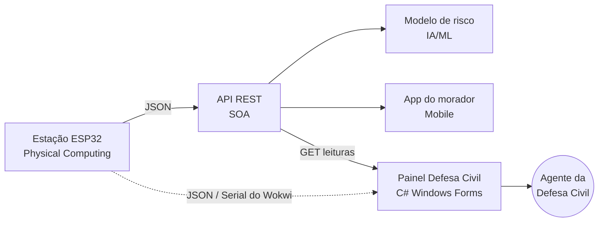

O painel usa **o mesmo contrato JSON da estação ESP32** (`estacaoId`, `setorId`, `timestamp`, `chuvaMm`, `umidadeSoloPct`, `nivelAguaCm`, `riscoLocal`...) e **os mesmos limiares de risco do firmware**, então estação e painel "falam a mesma língua". As leituras entram por três caminhos: colando as linhas `[API] POST ... | {json}` do Serial Monitor do Wokwi, abrindo um `.json`, ou com um `GET` na API do grupo. Se a API estiver fora do ar, o painel continua funcionando com os dados locais.

## Funcionalidades

| Aba | O que o agente faz | Regras/algoritmos envolvidos |
|---|---|---|
| **Visão geral** | Vê os indicadores de impacto, o "mapa" de setores coloridos pelo risco (chuva, solo, córrego e tendência) e a **fila de busca ativa** | Cálculo de risco, tendência, priorização, indicadores |
| **Leituras dos sensores** | Registra leitura manual (com prévia do risco enquanto digita), importa da estação/API, simula leituras, exclui leitura errada | Validação de faixas físicas, detecção de duplicadas, histerese |
| **Alertas** | Emite ou escala o alerta do setor, vê a mensagem enviada, acompanha a % de moradores seguros contra a meta, encerra o alerta | Um alerta ativo por setor, escalonamento, avisos antes de encerrar |
| **Moradores** | Cadastra/edita (dados simulados), marca "em local seguro" ou "pediu ajuda", filtra quem está na fila | Máquina de estados do morador, telefone mascarado (LGPD) |
| **Pontos de apoio** | Cadastra abrigos, registra chegada e saída de pessoas, vê o ranking de abrigos por setor | Capacidade nunca estoura; seleção por vagas, acessibilidade e distância |
| **Ocorrências** | Registra trincas/alagamentos/deslizamentos, envia equipe, resolve com parecer | Fluxo Aberta → Em atendimento → Resolvida; ordenação por urgência |

Além disso: **faixa de "alerta recomendado"** (vermelha) aparece no topo sempre que um setor sobe para MÉDIO/ALTO sem alerta compatível — a decisão continua com o operador, que emite com um clique — e **modo demonstração** (menu *Simulação*, `F6`) que gera uma leitura por setor a cada 4 s no cenário escolhido (estiagem, chuva moderada ou tempestade).

### Telas

| | |
|---|---|
| 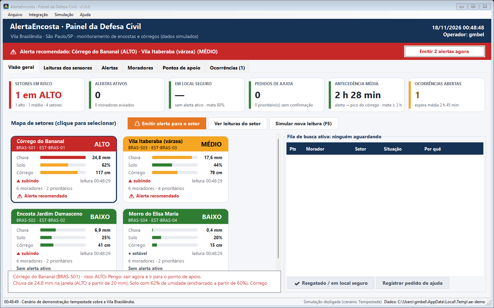 **Risco subiu: faixa de alerta recomendado** | 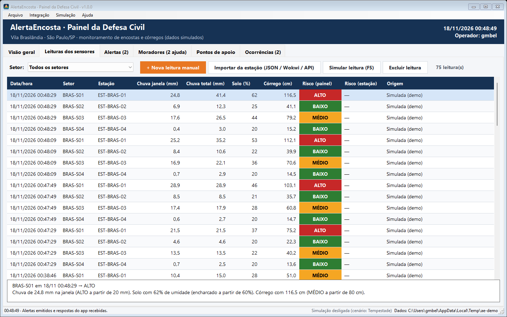 **Leituras com o risco do painel e da estação** |
| 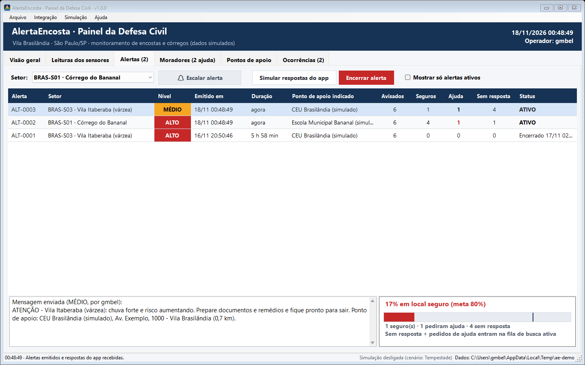 **Alertas: mensagem enviada e % em local seguro x meta** | 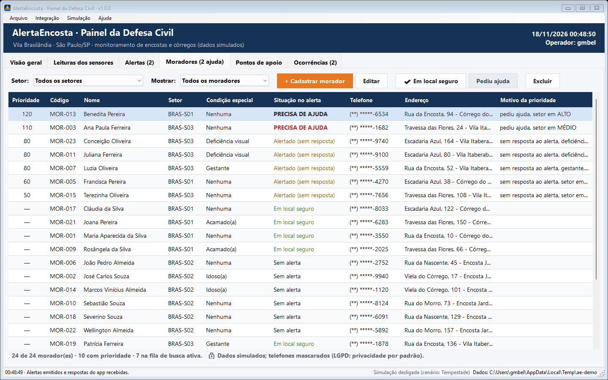 **Moradores ordenados por prioridade** |
| 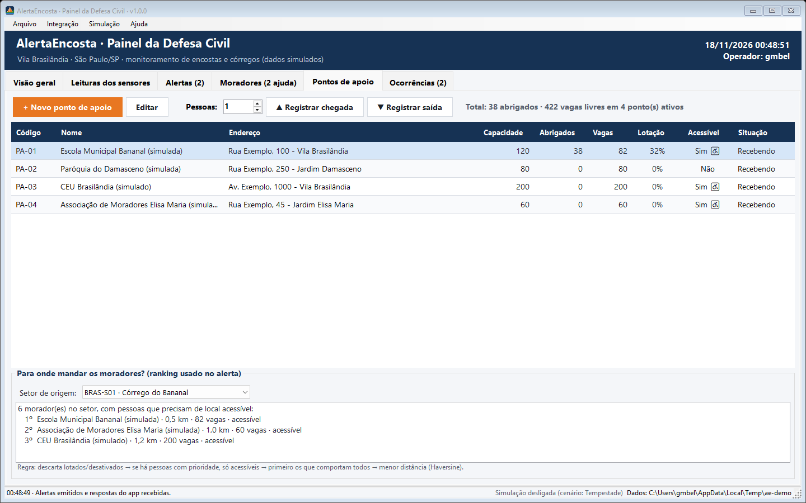 **Pontos de apoio e ranking por setor** | 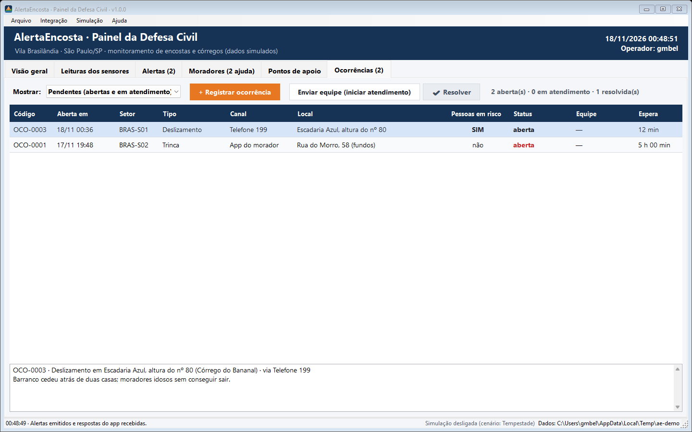 **Ocorrências por urgência** |
| 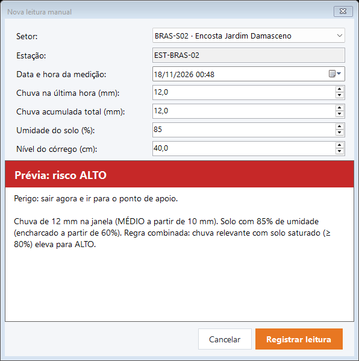 **Leitura manual com prévia do risco** | 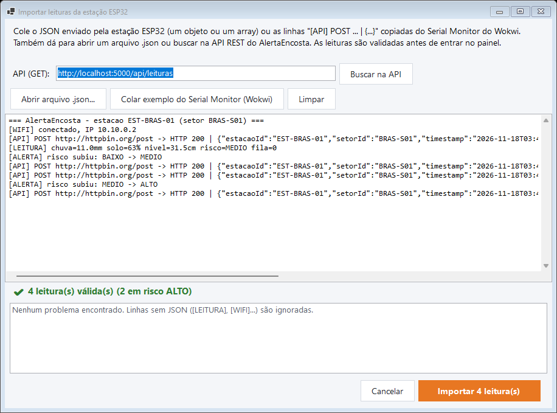 **Importação do Serial Monitor do Wokwi** |

## Lógica e algoritmos

**1. Risco de uma leitura** (`CalculadoraRisco`, mesmos limiares do `config.h` da estação):

| Sinal | MÉDIO a partir de | ALTO a partir de |
|---|---|---|
| Chuva na janela | 10 mm | 20 mm |
| Umidade do solo | 60 % | só combinada (abaixo) |
| Nível do córrego | 80 cm | 140 cm |
| **Regra combinada** | chuva ≥ MÉDIO **e** solo ≥ 80 % ⇒ **ALTO** (solo saturado + chuva = condição clássica de deslizamento) | |

O risco é o **maior** dos sinais. Cada avaliação devolve também os **motivos em texto simples** ("Chuva de 22 mm na janela (ALTO a partir de 20 mm)"), mostrados ao operador.

**2. Histerese — "sobe na hora, desce devagar"** (`ServicoMonitoramento.AplicarHisterese`): o risco do setor sobe imediatamente, mas só desce quando as **3 últimas leituras** estão todas abaixo do nível atual. Evita o alerta "pisca-pisca" quando o valor oscila no limiar. Leituras antigas importadas fora de ordem entram no histórico sem mudar o risco atual.

**3. Tendência** (`AnalisadorTendencia`): compara a leitura mais recente com a média das 3 anteriores (córrego ±5 cm, chuva ±2 mm) e mostra ▲ subindo / ▼ descendo / ● estável — o agente vê o setor piorando **antes** do limiar.

**4. Escolha do ponto de apoio** (`SeletorPontoApoio`): descarta abrigos lotados ou desativados → se o setor tem pessoas com prioridade, considera só os acessíveis (se houver) → ordena primeiro os que **comportam todos** os moradores do setor e depois pela **menor distância** (fórmula de Haversine entre o centro do setor e o abrigo).

**5. Fila de busca ativa** (`PriorizadorMoradores`): pontuação = pediu ajuda (+100) ou sem resposta ao alerta (+40) + pessoa com prioridade (+30, +10 se acamada ou com mobilidade reduzida) + setor em ALTO/MÉDIO (+20/+10). Quem já está seguro sai da fila; empate vai para quem espera há mais tempo.

**6. Indicadores de impacto** (`CalculadoraIndicadores`): **% em local seguro** = confirmados ÷ alertados (meta 80 %); **antecedência média** = minutos entre a emissão do alerta e o **pico do córrego** no setor dentro da janela do alerta (meta ≥ 2 h). Os dados de exemplo trazem um evento "de ontem" (alerta 2 h 28 min antes do pico) para o indicador ter base desde a primeira execução.

**Validações e fluxos de decisão** (todas no domínio, a tela só exibe a mensagem):
- leitura: faixas físicas (solo 0–100 %, córrego 0–400 cm, chuva 0–500 mm), data não futura, chuva total ≥ chuva da janela, setor cadastrado, sem duplicidade (mesma estação no mesmo segundo);
- alerta: não existe em BAIXO; no máximo um ativo por setor (se o risco sobe, é **escalado**); antes de encerrar, avisa se o setor ainda está em risco ou se há pedidos de ajuda pendentes;
- morador: nome, endereço e telefone com DDD; não troca de setor durante um alerta; não pode "pedir ajuda" depois de confirmar que está seguro;
- ponto de apoio: entrada nunca passa da capacidade; capacidade não fica menor que a ocupação; não desativa com gente abrigada;
- ocorrência: Aberta → Em atendimento → Resolvida, sem pular etapas;
- edição é **atômica**: se um campo é inválido, nada é alterado.

## Programação Orientada a Objetos

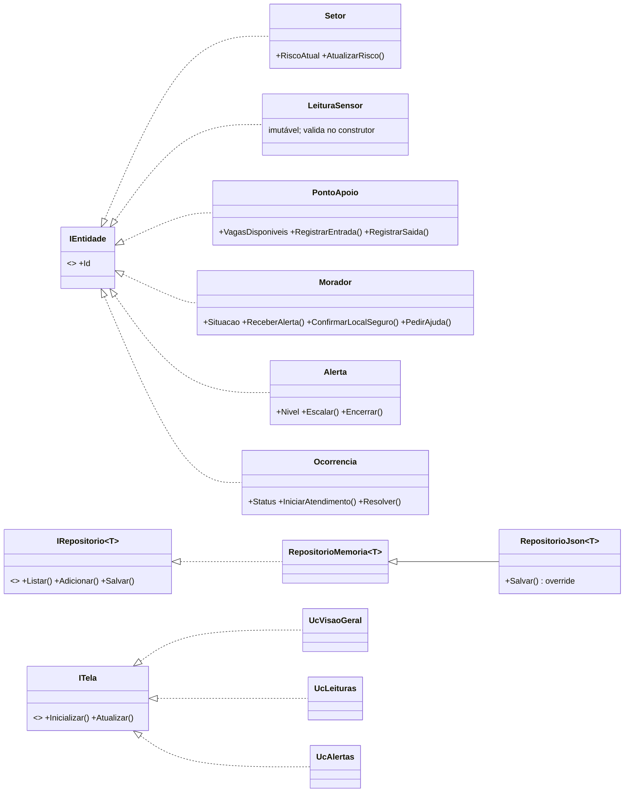

- **Encapsulamento:** todas as entidades têm `private set`; o estado só muda por métodos com regra (`RegistrarEntrada`, `Escalar`, `Resolver`...). Erros de regra viram `DominioException` com mensagem para o operador.
- **Herança e polimorfismo:** `RepositorioJson<T>` herda de `RepositorioMemoria<T>` e sobrescreve `Salvar()` (os testes usam a versão em memória; o app, a em JSON). As abas implementam `ITela` e a janela principal as trata de forma uniforme. `CartaoIndicador`, `BlocoSetor` e `BarraMeta` herdam de `Control` e desenham com GDI+.
- **Abstração/interfaces e genéricos:** `IEntidade`, `IRepositorio<T>`, `ITela`.
- **Composição e Observer:** `PainelContexto` monta os serviços uma vez e dispara `DadosAlterados`; as abas se atualizam sozinhas.
- **Separação em camadas:** `AlertaEncosta.Core` (domínio, serviços, integração e persistência, **sem nenhuma dependência de Windows Forms**) e `AlertaEncosta.Painel` (só interface). Por isso o Core é testado isoladamente.

## Persistência

Arquivos JSON em `%LocalAppData%\AlertaEncosta\PainelDefesaCivil\` (`setores.json`, `leituras.json`, `moradores.json`, `alertas.json`, `ocorrencias.json`, `pontos-apoio.json`). Gravação **atômica** (escreve um `.tmp` e troca), para não corromper os dados se a energia cair no meio do temporal; se um arquivo estiver corrompido, ele é copiado de lado em vez de apagado. Menu *Arquivo → Abrir pasta de dados* mostra os arquivos; *Restaurar dados de exemplo* volta ao início.

## Como executar

**Requisitos:** Windows 10/11 e o **SDK do .NET 10** (LTS) — vem com o **Visual Studio 2026** (carga de trabalho *Desenvolvimento para desktop com .NET*) ou pode ser instalado sozinho em <https://dotnet.microsoft.com/download/dotnet/10.0>.

**Visual Studio:** abra `AlertaEncosta.Painel.sln`, defina **AlertaEncosta.Painel** como projeto de inicialização e pressione `F5`.

**Linha de comando:**

```bash
dotnet run --project src/AlertaEncosta.Painel          # abre o painel
dotnet test                                             # roda os 49 testes de unidade
```

Na primeira execução o painel cria dados de exemplo (4 setores da Vila Brasilândia, 24 moradores fictícios, 4 pontos de apoio, leituras das últimas 2 h e um evento de ontem).

> **Só tem Visual Studio 2022 / .NET 8?** O código também compila em .NET 8: rode `dotnet build -p:DotNetAlvo=net8.0` ou troque `net10.0` por `net8.0` na propriedade `DotNetAlvo` do `Directory.Build.props`.

### Roteiro de demonstração (2 minutos)

1. **Visão geral:** o Córrego do Bananal começa em MÉDIO (chuva moderada) e a faixa laranja já recomenda alerta; o indicador de antecedência mostra o evento de ontem (2 h 28 min).
2. Menu **Simulação → Cenário: Tempestade** e **Gerar leitura (F5)** duas ou três vezes: os blocos ficam vermelhos, a tendência mostra ▲ e aparece a **faixa vermelha "Alerta recomendado"**.
3. **Emitir alerta agora:** o painel escolhe o ponto de apoio (vagas + acessibilidade + distância) e mostra a mensagem enviada aos moradores.
4. Aba **Alertas → Simular respostas do app:** a barra mostra a % em local seguro contra a meta de 80 %; quem pediu ajuda vai para o topo da **fila de busca ativa**.
5. Na fila, **Resgatado / em local seguro**; em **Pontos de apoio**, registrar a chegada das pessoas.
6. **Integração → Importar leituras → Colar exemplo do Serial Monitor (Wokwi):** as linhas da estação ESP32 viram leituras validadas.

### Evidências

As imagens em [`docs/images`](docs/images) foram geradas pelo próprio executável, rodando um cenário de tempestade numa pasta de dados separada:

```bash
PainelDefesaCivil.exe --dados "%TEMP%\alertaencosta-demo" --capturar-telas docs\images
```

## Estrutura do repositório

```
.
├── AlertaEncosta.Painel.sln
├── Directory.Build.props          # versão (SemVer), autores e framework alvo
├── CHANGELOG.md                   # histórico de versões
├── integrantes.txt                # RM, nome completo e link do repositório
├── prompts.md                     # uso de IA como copiloto
├── docs/images/                   # capturas de tela (evidências)
├── src/
│   ├── AlertaEncosta.Core/        # regras de negócio (sem Windows Forms)
│   │   ├── Dominio/               # entidades, enums e validações
│   │   ├── Servicos/              # risco, histerese, tendência, alertas, abrigos, fila, indicadores, simulador
│   │   ├── Integracao/            # contrato JSON da estação ESP32 e cliente da API REST
│   │   └── Persistencia/          # repositórios (memória/JSON) e dados de exemplo
│   └── AlertaEncosta.Painel/      # aplicação Windows Forms
│       ├── FormPrincipal.cs       # janela principal (menu, cabeçalho, faixa de aviso, abas)
│       ├── Telas/                 # uma UserControl por aba (ITela)
│       ├── Dialogos/              # formulários de cadastro e importação
│       └── Componentes/           # tema, controles desenhados (GDI+), ações compartilhadas
└── tests/AlertaEncosta.Core.Tests # 49 testes xUnit do domínio e dos serviços
```

## Tecnologias

C# 14 · .NET 10 (LTS) · Windows Forms · System.Text.Json · HttpClient · GDI+ (controles desenhados) · xUnit · Git (SemVer + Pull Request).

## Versionamento

O projeto segue **[Versionamento Semântico](https://semver.org/lang/pt-BR/)** (`MAJOR.MINOR.PATCH`): a versão fica em `Directory.Build.props` (aparece no título da janela e no *Sobre*), cada versão tem uma *tag* `vX.Y.Z` e as mudanças estão no [CHANGELOG](CHANGELOG.md). O desenvolvimento é feito em *branch* de funcionalidade (`feature/...`) e entra na `main` por **pull request**.

## Privacidade (LGPD) e limitações

- **Todos os dados são simulados** (nomes, telefones e endereços fictícios; abrigos marcados como "simulado"). Telefones aparecem mascarados nas telas; a exclusão de cadastro atende ao direito de eliminação.
- Os limiares são **didáticos** e iguais aos do firmware; em produção devem ser calibrados com Cemaden/CGE-SP e o **modelo de ML continua sendo a decisão oficial** — o painel é a ferramenta do operador e o plano B quando a rede cai.
- O envio do push ao morador é feito pela API (Expo Push); o painel registra o alerta e acompanha as respostas (no protótipo, simuladas).
- A autenticação do operador fica a cargo do Active Directory do Windows Server (parte de Operating Systems); o painel mostra o usuário do Windows logado.
